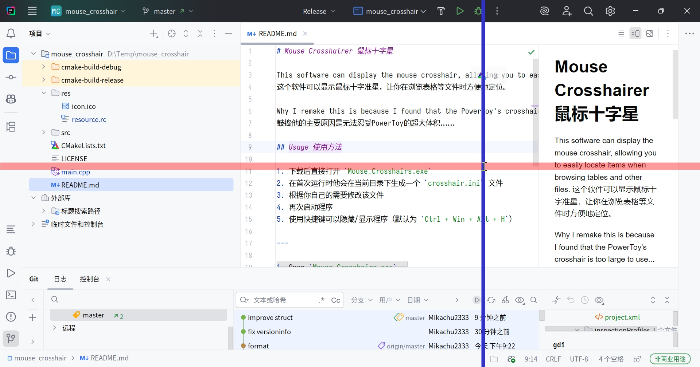

# Mouse Crosshairer 鼠标十字星



This software can display the mouse crosshair, allowing you to easily locate items when browsing tables and other files.

这个软件可以显示鼠标十字准星，让你在浏览表格等文件时方便地定位。

Why I remake this is because I found that the PowerToy's crosshair is too large to use...

鼓捣他的主要原因是无法忍受PowerToy的超大体积……

## Usage 使用方法

1. 下载后打开 `mouse_crosshair_x64.exe`（32 位系统使用 `mouse_crosshair_x86.exe`）
2. 首次运行时优先在程序目录生成 `crosshair.ini`；若该目录不可写，则保存到 `%LOCALAPPDATA%\MouseCrosshair\crosshair.ini`
3. 根据你自己的需要修改该文件
4. 使用 `Ctrl + Win + Alt + E` 退出
5. 使用快捷键可以隐藏/显示程序（默认为 `Ctrl + Win + Alt + H`）
6. 配置文件修改后，重新显示时会自动重载

<!--sth-->

1. Open `mouse_crosshair_x64.exe` (or `mouse_crosshair_x86.exe` on 32-bit Windows)
2. On first run, the app writes `crosshair.ini` next to the executable; if that directory is not writable, it uses `%LOCALAPPDATA%\MouseCrosshair\crosshair.ini`
3. Modify it as you need
4. Use `Ctrl + Win + Alt + E` to exit
5. Use the shortcut key to hide/show the crosshair (default is `Ctrl + Win + Alt + H`)
6. After editing config, show the crosshair again to reload automatically

## Features 功能

1. 支持自定义十字星颜色、粗细、透明度（横线竖线可以分别设置）
2. 支持自定义快捷键
3. 支持多显示器

<!--sth-->

1. Support customize crosshair color, thickness, transparency
   (horizontal and vertical lines can be set separately)
2. Support customize hotkeys
3. Support multi-monitor

## Usage 使用方式

参考下面的配置文件 Please see the following `ini` file as details

```ini
[Crosshair]
# The gap (empty space) around the mouse cursor
Gap = 20

[Horizontal]
# No more than 200
Width = 2
# R, G, B, Alpha: 0-255
R = 255
G = 0
B = 0
Alpha = 255

[Vertical]
# No more than 200
Width = 2
# R, G, B, Alpha: 0-255
R = 255
G = 0
B = 0
Alpha = 255

[Hide_Show_Hotkey]
# Modifiers Support
# Prefix: Ctrl, Alt, Win, Shift (Combine up to 4)
# Note: Fn keys (F1-F24) can be used entirely without any modifiers!
# To use single Fn key, leave Mod option empty like: Mod = 
# Warning: If Mod is invalid, the program will automatically set it to Ctrl+Alt+Win
Mod = Ctrl,Alt,Win

# Virtual Key Support
# - Letters: A-Z
# - Numbers: 0-9, Numpad0-Numpad9
# - Functions: F1-F24
# - Specials: Space, Tab, Backspace, Escape, Enter, Delete, Insert
# - Mouse: XButton1, XButton2
# Warning: If VK is invalid, the program will automatically set it to H
VK = H

[Exit_Hotkey]
# Same rule as Hide_Show_Hotkey
# Warning: If Mod is invalid, the program will automatically set it to Ctrl+Alt+Win
Mod = Ctrl,Alt,Win
# Warning: If VK is invalid, the program will automatically set it to E
VK = E
```
